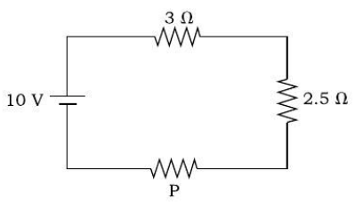

$\lambda_{e}$ அலைநீளம் கொண்ட எலக்ட்ரான் மற்றும் $\lambda_{p}$ அலைநீளம் கொண்ட ஃபோட்டான் ஆகியவை ஒரே ஆற்றலைப் (E) பெற்று இருப்பின் அலைநீளங்கள் $\lambda_{e}$ மற்றும் $\lambda_{p}$ இடையிலான தொடர்பு:
- $\lambda_{p}\propto\frac{1}{\sqrt{\lambda}_{e}}$
- $\lambda_{p}\propto\lambda_{e}$
- $\lambda_{p}\propto\lambda_{e}^{2}$
- $\lambda_{p}\propto\sqrt{\lambda}_{e}$

இரண்டு போலராய்டுகளின் பரவு அச்சுகள் ஒன்றுக்கொன்று 30° கோணத்தில் சாய்ந்துள்ள நிலையில், I செறிவு கொண்ட தளவிளைவு அற்ற ஒளி முதல் போலராய்டின் மீது விழுகின்றது. இரண்டாவது போலராய்டில் இருந்து வெளியேறும் ஒளியின் செறிவு:
- $\frac{1}{8}I$
- $\frac{1}{4}I$
- $\frac{3}{8}I$
- $\frac{3}{4}I$

மின்காந்த அலை ஒன்றின் காந்தப்புலத்தின் எண் மதிப்பு $3\times10^{-6}$ T எனில், அதன் மின்புலத்தின் மதிப்பு என்ன ?
- $600~Vm^{-1}$
- 100 Vm-1
- $900~Vm^{-1}$
- $300~Vm^{-1}$

பின்வரும் மின்சுற்றில் உள்ள மின்னோட்டம் 1.0 A எனில் மின்தடை P -யின் மதிப்பு என்ன ?

- 3.5 Ω
- 1.5 Ω
- 4.5 Ω
- 2.5 Ω

ஒரு கார்பன் மின்தடையாக்கியின் மின்தடை மதிப்பு $(47\pm4.7)$ k2 எனில் அதில் இடம் பெறும் நிறவளையங்களின் வரிசை :
- ஊதா - மஞ்சள் ஆரஞ்சு வெள்ளி
- மஞ்சள் - பச்சை ஊதா - தங்கம்
- பச்சை - ஆரஞ்சு ஊதா தங்கம்
- மஞ்சள் - ஊதா ஆரஞ்சு வெள்ளி

ஹைட்ரஜன் அணுவில் இரண்டாவது சுற்றுப்பாதையில் இயங்கும் எலக்ட்ரானின் கோண உந்தம் :
- $\frac{4h}{\pi}$
- h
- $\frac{2h}{\pi}$
- $\frac{h}{\pi}$

யங் இரட்டைப் பிளவு ஆய்வில், பிளவுகளுக்கு இடையே உள்ள தொலைவு இருமடங்காக்கப்படுகிறது. திரையில் தோன்றும் பட்டை அகலம் மாறாமல் இருக்க வேண்டுமெனில், பிளவுகளுக்கும் திரைக்கும் இடையே உள்ள தொலைவு (D) எவ்வளவு இருக்க வேண்டும் ?
- $\sqrt{2}D$
- 2D
- $\frac{D}{\sqrt{2}}$
- $\frac{D}{2}$

இணைத்தட்டு மின்தேக்கி ஒன்று V மின்னழுத்த வேறுபாட்டில் Q அளவு மின்னூட்டம் கொண்ட மின்துகள்களை சேமிக்கின்றது. தட்டுகளின் பரப்பளவும் தட்டுகளுக்கு இடையேயான தொலைவும் இருமடங்கானால் பின்வருவனவற்றுள் எந்த அளவு மாறுபடும் ?
- மின்னழுத்த வேறுபாடு
- மின்தேக்குத்திறன்
- ஆற்றல் அடர்த்தி
- மின்துகள்

$\vec{v}=v\hat{i}$ என்ற திசைவேகத்துடன் மின்காந்த அலை ஒரு ஊடகத்தில் பரவுகின்றது. இவ்வலையின் மாறுதிசை மின்புலம் + Y அச்சின் திசையில் இருந்தால் அதன் மாறுதிசை காந்தப்புலம் இருக்கும்.
- +Z திசையில்
- -Y திசையில்
- -Z திசையில்
- -X திசையில்

காற்றிலிருந்து ஒளிவிலகல் எண் 2 கொண்ட கண்ணாடிப் பட்டகத்தின் மீது ஒளி விழுகிறது எனில், சாத்தியமான பெரும விலகு கோணத்தின் மதிப்பு :
- $60^{\circ}$
- $30^{\circ}$
- $90^{\circ}$
- $45^{\circ}$

செனார் டையோடின் முதன்மை பயன்பாடு :
- அலை இயற்றி
- அலை திருத்தி
- மின்னழுத்தச் சீரமைப்பான்
- பெருக்கி

t என்ற கணத்தில், ஒரு சுருளோடு தொடர்புடைய பாயம் $\Phi_{B}=15t^{2}-50t+250$ என உள்ளது. $t=3$ இல் தூண்டப்பட்ட மின்னியக்கு விசையானது :
- -40 V
- -190 V
- 40 V
- -10 V

டயா காந்தப்பொருளுக்கு எடுத்துக்காட்டு :
- நிக்கல்
- தண்ணீர்
- அலுமினியம்
- இரும்பு

அறை வெப்பநிலையில் சிலிகானின் விலக்கப்பட்ட ஆற்றல் இடைவெளியின் மதிப்பு என்ன ?
- 0.3 eV
- 0.7 eV
- 0.9 eV
- 1.1 eV

ரோபோக்களில் தசைக் கம்பிகள் உருவாக்கப் பயன்படும் உலோகக் கலவைகள் :
- தங்கம் வெள்ளி உலோகக் கலவைகள்
- வடிவ நினைவு உலோகக் கலவைகள்
- இரு பரிமாண உலோகக் கலவைகள்
- தங்கம் தாமிர உலோகக் கலவைகள்
