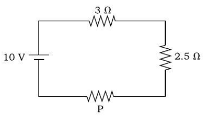

The wavelength $\lambda_{e}$ of an electron and $\lambda_{p}$ of a photon of same energy E are related by:
- $\lambda_{p}\propto\frac{1}{\sqrt{\lambda}_{e}}$
- $\lambda_{p}\propto\lambda_{e}$
- $\lambda_{p}\propto\lambda_{e}^{2}$
- $\lambda_{p}\propto\sqrt{\lambda}_{e}$

Two polaroids are kept with their transmission axes inclined at $30^{\circ}$. Unpolarised light of intensity I falls on the first polaroid. Intensity of light emerging from the second polaroid :
- $\frac{1}{8}I$
- $\frac{1}{4}I$
- $\frac{3}{8}I$
- $\frac{3}{4}I$

If the magnitude of the magnetic field is $3\times10^{-6}T$, then the magnitude of the electric field for a electromagnetic wave is:
- $600~Vm^{-1}$
- $100~Vm^{-1}$
- $900~Vm^{-1}$
- $300~Vm^{-1}$

There is a current of 1.0 A in the circuit shown below. What is the resistance of P?

- 3.5 Ω
- 1.5 Ω
- 4.5 Ω
- 2.5 Ω

A carbon resistor of $(47\pm4.7)$ ko is to be marked with rings of different colours for its identification. The colour code sequence will be:
- Violet Yellow Orange - Silver
- Yellow Green Violet - Gold
- Green Orange Violet - Gold
- Yellow Violet Orange Silver

In an hydrogen atom, the electron revolving in the second orbit, has angular momentum :
- $\frac{4h}{\pi}$
- h
- $\frac{2h}{\pi}$
- $\frac{h}{\pi}$

In Young's double-slit experiment, the slit separation is doubled. To maintain the same fringe spacing on the screen, the screen-to-slit distance D must be changed to:
- $\sqrt{2}D$
- 2D
- $\frac{D}{\sqrt{2}}$
- $\frac{D}{2}$

A parallel plate capacitor stores a charge Q at a voltage V. Suppose the area of the parallel plate capacitor and distance between the plates are each doubled then which is the quantity that will change ?
- Voltage
- Capacitance
- Energy density
- Charge

An electromagnetic wave is propagating in a medium with velocity $\vec{v}=v\hat{i}$. The instantaneous oscillating electric field of this electromagnetic wave is along +Y axis, then the direction of oscillating magnetic field of the electromagnetic wave will be along:
- +Z direction
- -Y direction
- -Z direction
- -X direction

For light incident from air on a slab of refractive index 2, the maximum possible angle of refraction is:
- $60^{\circ}$
- $30^{\circ}$
- $90^{\circ}$
- $45^{\circ}$

The Zener diode is primarily used as:
- Oscillator
- Rectifier
- Voltage regulator
- Amplifier

The flux linked with a coil at any instant t is given by $\Phi_{B}=15t^{2}-50t+250.$ The induced emf at $t=3$ is:
- -40 V
- - 190 V
- 40 V
- - 10 V

An example of Diamagnetic material is
- Nickel
- Water
- Aluminium
- Iron

What is value of Forbidden Energy gap for silicon at room temperature ?
- 0.3 eV
- 0.7 eV
- 0.9 eV
- 1.1 eV

The alloys used for muscle wires in Robots are:
- Gold silver alloys
- Shape memory alloys
- Two dimensional alloys
- Gold copper alloys
