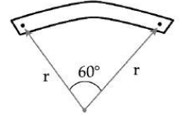
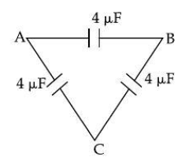

சூரிய மின்கலன் __________ தத்துவத்தின் அடிப்படையில் செயல்படுகிறது.
- ஒளி வோல்டா செயல்பாடு
- விரவல்
- ஊர்தியின் பாய்வு
- மறு இணைப்பு

மின்காந்த அலை ஒன்றின் காந்தப்புலத்தின் எண்மதிப்பு $3 \times 10^{-6}$ T எனில், அதன் மின்புலத்தின் மதிப்பு என்ன ?
- 600 Vm$^{-1}$
- 100 Vm$^{-1}$
- 900 Vm$^{-1}$
- 300 Vm$^{-1}$

ஒரு ரொட்டி சுடும் மின்இயந்திரம் 240 V -இல் செயல்படுகிறது. அதன் மின்தடை 120 Ω எனில், அதன் திறன் :
- 240 W
- 400 W
- 480 W
- 2 W

n = 1 சுற்றுப்பாதைக்கு அயனியாக்க அழுத்தம் 122.4 V கொண்ட H - மாதிரி அணுவின் அணு எண் :
- 3
- 4
- 2
- 1

ஒளியின் குறுக்கலைப் பண்பினை வெளிப்படுத்தும் நிகழ்வு :
- ஒளிச்சிதறல்
- குறுக்கீட்டு விளைவு
- தளவிளைவு
- விளிம்பு விளைவு

ஒரு அலைவுறும் LC சுற்றில் மின்தேக்கியில் உள்ள பெரும மின்னூட்டம் Q ஆகும். ஆற்றலானது மின் மற்றும் காந்தப்புலங்களில் சமமாக சேமிக்கப்படும் போது, மின்னூட்டத்தின் மதிப்பு :
- $\frac{Q}{\sqrt{2}}$
- $\frac{Q}{2}$
- Q
- $\frac{Q}{\sqrt{3}}$

‘$\ell$’ நீளமும் ‘$P_m$’ காந்த திருப்புத்திறனும் கொண்ட சட்டகாந்தம் ஒன்று படத்தில் காட்டியுள்ளவாறு வில் போன்று வளைக்கப்பட்டுள்ளது. சட்டக்காந்தத்தின் புதிய காந்த இருமுனை திருப்புத் திறனின் மதிப்பு :

- $\frac{2}{\pi} P_m$
- $P_m$
- $\frac{1}{2} P_m$
- $\frac{3}{\pi} P_m$

திசையொப்பு பண்பினைப் பெற்ற ஊடகத்தின் வழியே செல்லும் ஒளியின் வேகம், பின்வருவனவற்றுள் எதனைச் சார்ந்துள்ளது ?
- பரவும் தன்மை
- அதன் ஒளிச்செறிவு
- ஊடகத்தைப் பொருத்து ஒளிமூலத்தின் இயக்கம்
- அதன் அலைநீளம்

ஒரு தொடர் RL சுற்றில், மின்தடை மற்றும் மின்தூண்டல் மின்மறுப்பு இரண்டும் சமமாக உள்ளன. சுற்றில் மின்னழுத்த வேறுபாடு மற்றும் மின்னோட்டம் இடையே உள்ள கட்ட வேறுபாடு :
- $\frac{\pi}{6}$
- $\frac{\pi}{4}$
- சுழி
- $\frac{\pi}{2}$

$q_1$ மற்றும் $q_2$ ஆகிய நேர்மின்னூட்ட அளவு கொண்ட இரு ஒரே மாதிரியான மின்கடத்துப் பந்துகளின் மையங்கள் ‘r’ இடைவெளியில் பிரிக்கப்பட்டுள்ளன. அவற்றை ஒன்றோடொன்று தொடச் செய்துவிட்டு பின்னர் அதே இடைவெளியில் பிரித்து வைக்கப்படுகின்றன எனில், அவற்றிற்கு இடையேயான விசை :
- முன்பை விட அதிகமாக இருக்கும்
- முன்பை விடக் குறைவாக இருக்கும்
- சுழி
- அதேயளவு இருக்கும்

மூன்று மின்தேக்கிகள் படத்தில் உள்ளவாறு முக்கோண வடிவமைப்பில் இணைக்கப்பட்டுள்ளன. A மற்றும் C ஆகிய புள்ளிகளுக்கிடையே உள்ள இணைமாற்று மின்தேக்குத் திறன் :

- 4 μF
- 2 μF
- 8 μF
- 6 μF

ஒளிமின் வெளியேற்று ஆற்றல் 3.313 eV கொண்ட ஒரு உலோகப்பரப்பின் பயன் தொடக்க அலைநீளம் :
- 6000 Å
- 4125 Å
- 2062.5 Å
- 3750 Å

நிகோல் பட்டகம் வழியாகச் செல்லும் ஒளி :
- முழுவதும் தளவிளைவு அடையும்
- பகுதி தளவிளைவு அடையும்
- நீள்வட்டமாகத் தளவிளைவு அடையும்
- தளவிளைவு அடையாது

ஈர்ப்பு அலைகளை கருத்தியலாக முன்மொழிந்தவர் :
- ஆல்பர்ட் ஐன்ஸ்டீன்
- கான்ராட் ரோன்ட்ஜென்
- எட்வார்டு பர்செல்
- மேரி கியூரி

அறை வெப்பநிலையில் சிலிக்கானின் விலக்கப்பட்ட ஆற்றல் இடைவெளி மதிப்பு :
- 1.1 V
- 0.7 eV
- 1.1 eV
- 0.7 V
