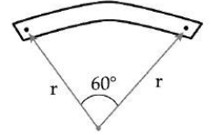
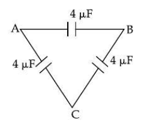

The principle based on which a solar cell operates is :
- Photovoltaic action
- Diffusion
- Carrier flow
- Recombination

If the amplitude of the magnetic field is $3 \times 10^{-6}$ T, then the amplitude of the electric field for a electromagnetic wave is :
- 600 Vm$^{-1}$
- 100 Vm$^{-1}$
- 900 Vm$^{-1}$
- 300 Vm$^{-1}$

A toaster operating at 240 V has resistance of 120 Ω. Its power is :
- 240 W
- 400 W
- 480 W
- 2 W

Atomic number of H - like atom with ionization potential 122.4 V for n = 1 is :
- 3
- 4
- 2
- 1

The transverse nature of light is shown in :
- scattering
- interference
- polarisation
- diffraction

In an oscillating LC circuit, the maximum charge on the capacitor is Q. The charge on the capacitor when the energy is stored equally between the electric and magnetic field is :
- $\frac{Q}{\sqrt{2}}$
- $\frac{Q}{2}$
- Q
- $\frac{Q}{\sqrt{3}}$

A bar magnet of length ‘$\ell$’ and magnetic moment ‘$P_m$’ is bent in the form of an arc as shown in figure. The new magnetic dipole moment will be :

- $\frac{2}{\pi} P_m$
- $P_m$
- $\frac{1}{2} P_m$
- $\frac{3}{\pi} P_m$

The speed of light in an isotropic medium depends on :
- the nature of propagation
- its intensity
- the motion of the source w.r.t. medium
- its wavelength

In a series RL circuit, the resistance and inductive reactance are the same. Then the phase difference between voltage and current in the circuit is :
- $\frac{\pi}{6}$
- $\frac{\pi}{4}$
- Zero
- $\frac{\pi}{2}$

Two identical conducting balls having positive charges $q_1$ and $q_2$ are separated by a center to center distance ‘r’. If they are made to touch each other and then separated to the same distance, the force between them will be :
- more than before
- less than before
- zero
- same as before

Three capacitors are connected in triangle as shown in figure. The equivalent capacitance between the points A and C is :

- 4 μF
- 2 μF
- 8 μF
- 6 μF

The threshold wavelength for a metal surface whose photoelectric work function is 3.313 eV :
- 6000 Å
- 4125 Å
- 2062.5 Å
- 3750 Å

Light transmitted by Nicol prism is :
- plane polarised
- partially polarised
- elliptically polarised
- unpolarised

The gravitational waves were theoretically proposed by :
- Albert Einstein
- Conrod Rontgen
- Edward Purcell
- Marie Curie

The value of forbidden energy gap for Si at room temperature is :
- 1.1 V
- 0.7 eV
- 1.1 eV
- 0.7 V
