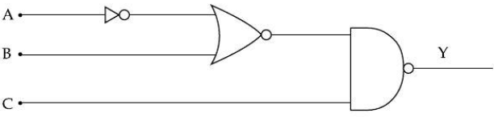
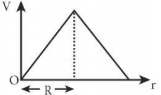
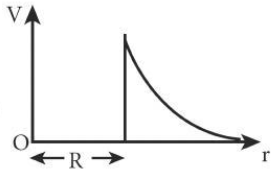
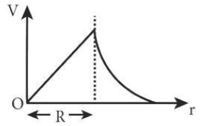
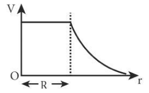

கீழ்க்காணும் லாஜிக் கேட்டுகளின் சேர்க்கையில், உள்ளீடுகள் A, B, C கொண்டு வெளியீடு Y-க்கான பூலியன் சமன்பாடு எழுதுக.

- $\overline{A}\,B\,\overline{C}$
- $A\overline{B}C$
- $\overline{A}+\overline{B}+\overline{C}$
- $\overline{A}+B+\overline{C}$

500 Am$^{-1}$ காந்தமாக்கு செறிவு கொண்ட பொருளினை 1000 Am$^{-1}$ மதிப்புடைய காந்தமாக்கு புலத்தில் வைக்கும்போது அப்பொருளின் காந்த ஏற்புத்திறன் மதிப்பு யாது ?
- 0.2
- 0.8
- 0.7
- 0.5

ஒரு மின்மாற்றியில் முதன்மை மற்றும் துணைச் சுற்றுகளில் முறையே 410 மற்றும் 1230 சுற்றுகள் உள்ளன. முதன்மைச்சுருளில் உள்ள மின்னோட்டம் 6 A எனில், துணைச் சுருளின் மின்னோட்டமானது :
- 12 A
- 2 A
- 1 A
- 18 A

ஜூலின் வெப்ப விதியில், R மற்றும் t மாறிலிகளாக உள்ளது. H -ஐ $y$ அச்சிலும் $I^2$ -ஐ $x$ அச்சிலும் கொண்டு வரையப்பட்ட வரைபடம் ஒரு :
- வட்டம்
- நேர்க்கோடு
- நீள்வட்டம்
- பரவளையம்

$\frac{1}{\mu_0 \epsilon_0}$ -ன் பரிமாணம் :
- $[L^{-1} T]$
- $[L T^{-1}]$
- $[L^{-2} T^2]$
- $[L^2 T^{-2}]$

‘ஸ்கி மெழுகு’ என்பது நானோ பொருளின் பயன்பாடு ஆகும். அது பயன்படும் துறை :
- விளையாட்டு
- மருத்துவம்
- வாகன தொழிற்சாலை
- ஜவுளி

$2 \times 10^5$ NC$^{-1}$ மதிப்புள்ள மின்புலத்தில் 30° ஒருங்கமைவு கோணத்தில் மின் இருமுனை ஒன்று வைக்கப்பட்டுள்ளது. அதன் மீது செயல்படும் திருப்பு விசையின் மதிப்பு 8 Nm. மின் இருமுனையின் நீளம் 1 cm எனில் அதிலுள்ள ஒரு மின் துகளின் மின்னூட்ட மதிப்பு :
- 5 mC
- 4 mC
- 7 mC
- 8 mC

காற்றிலிருந்து ஒளிவிலகல் எண் 2 கொண்ட கண்ணாடிப் பட்டகத்தின் மீது ஒளி விழுகிறது எனில், சாத்தியமான பெரும விலகுகோணத்தின் மதிப்பு என்ன ?
- 60°
- 30°
- 90°
- 45°

t = 0 நேரத்தில் கதிரியக்க தனிமம் ஒன்றிலுள்ள அணுக்கருக்களின் எண்ணிக்கை $N_0$. அரை ஆயுட்காலத்தில் பாதியளவு காலம் $\left(t = \frac{1}{2} T_{1/2}\right)$ ஆகும்போது உள்ள அணுக்கருக்களின் எண்ணிக்கை :
- $\frac{N_0}{4}$
- $\frac{N_0}{2}$
- $\frac{N_0}{8}$
- $\frac{N_0}{\sqrt{2}}$

500 nm அலைநீளம் உடைய ஒளி 0.5 mm அகலமுடைய துளையின் வழியே செல்லும் போது விளிம்பு விளைவு அடைகிறது. இந்நிகழ்வில் கதிர் ஒளியியலைப் பயன்படுத்தும் தொலைவினைக் காண்க.
- 20 cm
- 25 m
- 25 cm
- 30 cm

$1.0 \times 10^{-5}$ cm அகலம் கொண்ட ஒற்றைப் பிளவினால் ஏற்படும் விளிம்பு விளைவின் முதல் சிறுமம் 30° எனில், பயன்படுத்தப்படும் ஒளியின் அலைநீளம் என்ன ?
- 600 Å
- 400 Å
- 700 Å
- 500 Å

R ஆரமுடைய மின்கடத்துப் பொருளாலான, மெல்லிய கோளக் கூட்டின் பரப்பில் Q மின்னூட்ட அளவுள்ள மின்துகள்கள் சீராகப் பரவியுள்ளன எனில், அதனால் ஏற்படும் நிலை மின்னழுத்தத்திற்கான சரியான வரைபடம் எது ?
- 
- 
- 
- 

ஒளிமின் உமிழ்வு நிகழ்வில், ஒரு குறிப்பிட்ட உலோகத்தின் பயன்தொடக்க அதிர்வெண்ணை விட 4 மடங்கு அதிர்வெண் கொண்ட கதிர்வீச்சு அந்த உலோகப்பரப்பில் படும்போது, வெளிப்படும் எலக்ட்ரானின் பெரும திசைவேகமானது,
- $2\sqrt{\frac{h\nu_0}{m}}$
- $\sqrt{\frac{h\nu_0}{m}}$
- $\sqrt{\frac{h\nu_0}{2m}}$
- $\sqrt{\frac{6h\nu_0}{m}}$

ஓர் அலை இயற்றியில் தொடர்ச்சியான அலைவுகள் ஏற்பட :
- பின்னூட்ட மாறிலி ஒன்றாக இருக்க வேண்டும்.
- கட்ட மாற்றம் சுழி அல்லது 2π -யாக இருக்க வேண்டும்.
- நேர் பின்னூட்டம் இருக்க வேண்டும்.
- மேற்கூறிய அனைத்தும்.

ஒளியின் குறுக்கலைப் பண்பினை வெளிப்படுத்தும் நிகழ்வு :
- ஒளிச்சிதறல்
- குறுக்கீட்டு விளைவு
- தளவிளைவு
- விளிம்பு விளைவு
