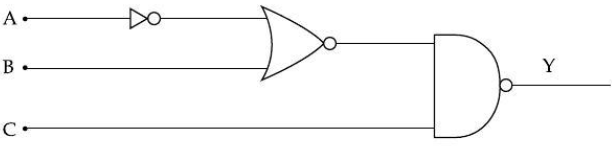
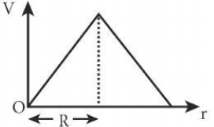
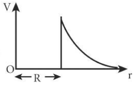
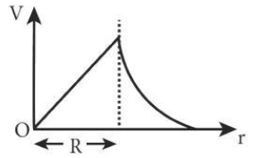
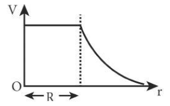

In the combination of the following gates, write the Boolean equation for output Y in terms of input A, B, C.

- $\overline{A}\,B\,\overline{C}$
- $A\overline{B}C$
- $\overline{A}+\overline{B}+\overline{C}$
- $\overline{A}+B+\overline{C}$

If a material having intensity of magnetisation 500 Am$^{-1}$ is placed in a magnetising field of 1000 Am$^{-1}$, then the susceptibility of the material is :
- 0.2
- 0.8
- 0.7
- 0.5

In a transformer, the number of turns in the primary and the secondary are 410 and 1230 respectively. If the current in primary is 6 A, then that in the secondary coil is :
- 12 A
- 2 A
- 1 A
- 18 A

In Joule's heating law, when R and t are constant, if the H is taken along the $y$-axis and $I^2$ along the $x$-axis, the graph is :
- circle
- straight line
- ellipse
- parabola

The dimension of $\frac{1}{\mu_0 \epsilon_0}$ is :
- $[L^{-1} T]$
- $[L T^{-1}]$
- $[L^{-2} T^2]$
- $[L^2 T^{-2}]$

“Ski wax” is an application of nano product in the field of :
- Sports
- Medicine
- Automotive industry
- Textile

An electric dipole is placed at an alignment angle of 30° with an electric field of $2 \times 10^5$ NC$^{-1}$. It experiences a torque equal to 8 Nm. The charge on the dipole if the dipole length is 1 cm is :
- 5 mC
- 4 mC
- 7 mC
- 8 mC

For light incident from air on a slab of refractive index 2, the maximum possible angle of refraction is :
- 60°
- 30°
- 90°
- 45°

A radioactive element has $N_0$ number of nuclei at t = 0. The number of nuclei remaining after half of a half-life (that is, at time $t = \frac{1}{2} T_{1/2}$) is :
- $\frac{N_0}{4}$
- $\frac{N_0}{2}$
- $\frac{N_0}{8}$
- $\frac{N_0}{\sqrt{2}}$

Calculate the distance upto which ray optics is a good approximation for light of wavelength 500 nm falls on an aperture of width 0.5 mm.
- 20 cm
- 25 m
- 25 cm
- 30 cm

First diffraction minimum due to a single slit of width $1.0 \times 10^{-5}$ cm is at 30°. Then wavelength of light used is :
- 600 Å
- 400 Å
- 700 Å
- 500 Å

A thin conducting spherical shell of radius R has a charge Q which is uniformly distributed on its surface. The correct plot for electrostatic potential due to this spherical shell is :
- 
- 
- 
- 

In photoelectric emission, a radiation whose frequency is 4 times threshold frequency of a certain metal is incident on the metal. Then, the maximum possible velocity of the emitted electron will be :
- $2\sqrt{\frac{h\nu_0}{m}}$
- $\sqrt{\frac{h\nu_0}{m}}$
- $\sqrt{\frac{h\nu_0}{2m}}$
- $\sqrt{\frac{6h\nu_0}{m}}$

To obtain sustained oscillation in an oscillator,
- Feedback factor must be unity
- Phase shift must be 0 or 2π
- Feedback should be positive
- All the above

The transverse nature of light is shown in :
- scattering
- interference
- polarisation
- diffraction
