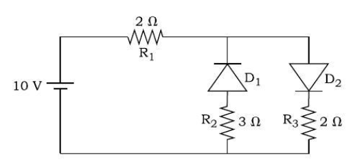

புள்ளி மின்துகள் ஒன்றினால் ஏற்படும் நிலை மின்னழுத்தத்திற்கான கோவையைத் தருவிக்க.

கிர்க்காஃபின் முதல் மற்றும் இரண்டாம் விதிகளை கூறுக.

கால்வனோமீட்டரை, அம்மீட்டராக எவ்வாறு மாற்றுவாய் என்பதை விவரிக்கவும்.

ஒரு சுருள் உள்ளடக்கிய பரப்பை மாற்றுவதன் மூலம், ஒரு மின்னியக்கு விசையை எவ்வாறு தூண்டலாம் ?

பிரான்ஹோபர் வரிகள் என்றால் என்ன ? சூரியனிலுள்ள தனிமங்களைக் கண்டறிவதில் அவை எவ்வாறு உதவுகின்றன ?

தரப்பட்டுள்ள மின்சுற்றில் இரண்டு நல்லியல்பு டையோடுகள் படத்தில் காட்டியுள்ளவாறு இணைக்கப்பட்டுள்ளன. மின்தடை $R_{1}$ வழியே பாயும் மின்னோட்டத்தைக் கணக்கிடுக.

ஒளிப்பாதை என்றால் என்ன ? ஒளிப்பாதையின் சமன்பாட்டை எழுதி அதிலுள்ள ஒவ்வொரு குறியீடும் எதைச் சுட்டுகின்றது என்பதைக் கூறுக.

ஏதேனும் மூன்று ஒளிமின் விளைவு விதிகளை எழுதுக.

1 kg நிறையுள்ள ${}_{92}^{235}U$ பிளவுறும் போது வெளிப்படும் ஆற்றலை ஜூலில் கணக்கிடுக.
