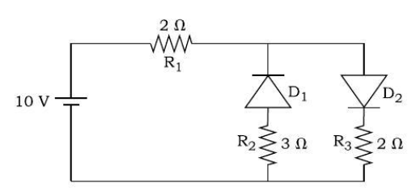

Derive an expression for electrostatic potential due to a point charge.

State Kirchhoff's First and Second Rules.

Explain the conversion of galvanometer into an ammeter.

How will you induce an emf by changing the area enclosed by the coil ?

What are Fraunhofer lines? How are they useful in the identification of elements present in the Sun ?

The given circuit has two ideal diodes connected as shown in figure below. Calculate the current flowing through the resistance $R_{1}$.

What is optical path? Write down the equation for optical path and mention what each term represents.

Write any three Laws of Photoelectric Effect.

Calculate the amount of energy released in joules when 1 kg of ${}_{92}^{235}U$ undergoes fission reaction.
